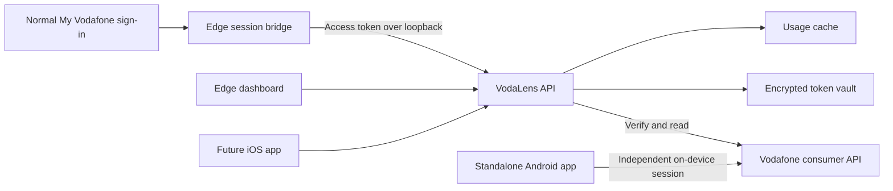

# Shared backend architecture

The active approach is a user-initiated browser-session handoff. Registered OAuth code remains isolated as research; it is not used by the default backend.

The backend calls only the observed read-only account, usage history and consumption endpoints on `dsapi.vodafone.com.au`. It checks account data before storing a session. Access tokens are encrypted with AES-256-GCM and owner-bound associated data; the vault key is kept outside SQLite. Usage data is owner-scoped in SQLite, with exact bytes and carrier-recorded dates. Request/response bodies and credential-bearing URLs are not logged.

Service discovery normalizes `accountDetails.accountDetail.billingAccount[].asset[]`: `msisdn`, `displayPlanName`, `accountType` and `serviceType`. Only those service fields reach `GET /v1/services`; account and billing-account identifiers stay out of that response. Unknown envelopes and conflicting duplicate services fail explicitly, and unsupported assets are counted as skipped.

## Connection lifecycle

1. The owner opens My Vodafone and chooses **Connect this tab** in the addon.
2. A five-minute arm pins the handoff to that tab. The addon reloads it.
3. The page's next allowlisted account/usage request supplies an access token to the isolated extension relay.
4. Only the extension service worker knows the backend credential. It sends the access token to `POST /v1/auth/vodafone/session` over loopback.
5. The backend reads Vodafone account data, encrypts the accepted token, and returns credential-free status.
6. Apps call the unified API using a VodaLens session. They never receive the stored Vodafone token.
7. Token expiry or an upstream 401 requires a new My Vodafone handoff. A replacement token is verified before replacing a working connection.

Decoded JWT expiry is only a lifetime hint; the backend does not trust it as authentication. Opaque tokens receive a ten-minute local TTL. JWT lifetimes are capped at 24 hours and each imported token must pass a real API read. There is no refresh-token replay or automatic claim of persistent access. Refreshing the website does not guarantee that it will issue a new token.

## Isolated renewal experiment

The website's normal refresh-token exchange has been observed without cookies or a client secret. Its refresh token rotates. A separately approved local experiment verified that same session continuation from Node twice after natural access-token expiry, using the public client ID to which the credential was originally issued. Each exchange returned a rotated refresh token and a 300-second access token that passed an account API read for the signed-in services. The donor website did not participate. [Safe live evidence](evidence/renewal-backend-probe.json). This does not register VodaLens as an OAuth client or provide a new native callback.

The research routes are owner-authenticated, loopback-only and inactive until a one-time arm is created. The addon first stages the credential into an encrypted vault, then removes only its matching Auth0 cache entry, unloads the donor page and commits the experiment. The backend waits for expiry, makes at most two token exchanges and verifies each resulting access token with the account API. It retains a rotated credential before API verification, stops on the first failure and never resumes grants automatically after a restart. Normal session-import routes continue to reject refresh credentials.

The successful experiment supports giving one backend connection sole ownership of a refresh-token family in a future backend design. Clients using that backend would have their own revocable VodaLens device sessions. Renewal must be serialized across every backend worker, and interactive Vodafone sign-in must remain available when renewal is rejected. Android instead uses the independently verified on-device design below. Remote-host behavior and Vodafone's refresh-token lifetime remain separate proof requirements; the bounded backend experiment does not establish them. The research job stopped after its second exchange and has not enabled production automatic backend renewal.

## Data semantics

### Standalone Android

The user selected a standalone Android app with on-device credentials and Material You wallpaper colours. Android connects directly to the fixed Vodafone HTTPS endpoints and does not use the local backend, desktop credentials or a shared server session. Its native login activity loads the official My Vodafone site with a main-frame bridge restricted to the exact website origin. The user activates the handoff; the site’s matching cache entry is retired before native use. The installed carrier app's package-specific callback is not reused.

Android Keystore AES-GCM protects the credential and normalized cache in `noBackupFilesDir`. A process-wide gate serializes rotation, and a durable uncertain marker prevents replay after a lost response or restart. Known offline state leaves the credential intact. Daily totals preserve every reported byte while keeping six months of cached history small. Current data opens from cache before a foreground sync; reopening a retained process refreshes snapshots older than five minutes. No polling service, background keepalive or desktop bridge is needed. Cycle progress includes elapsed time within the current day and respects daylight saving.

Current billing uses the live `amountDue`, not a historical invoice's `remainingAmount`. Paid status clears outstanding debt while the history keeps the original invoice total. Legacy billing cache entries are invalidated without discarding usage history. Usage, service history and billing retain separate last-successful-update timestamps.

Real Pixel reads verified multiple services and one deduplicated shared pool, all six previous usage cycles, six recent invoices and native renewal after expiry. Carrier reporting delay and complete pagination/finality remain provider limitations. [Android verification](evidence/android-validation.json).

### Backend HTTP ranges

History sync inputs use inclusive `start`/`end` dates and accept at most 91 dates. Returned cached ranges use an exclusive `end`. The carrier's unzoned timestamps retain their recorded calendar date. An unsynced day remains `null`; a fetched window can report zero returned data sessions. Carrier reporting delay, pagination and full retention are still unverified; fetched-window coverage is not a billing-finality guarantee.

Shared buckets are keyed by bucket ID and billing period, counted once across lines. Per-line allowance counters were inconsistent with the actual shared pool, so they cannot set the shared quota. Allowance and billing-cycle dates come from the signed-in account; live bucket dates take precedence when available. Vodafone uses 1 GB = 1,024 MB ([Vodafone support](https://www.vodafone.com.au/support/plans/manage-data)).

## Deployment boundary

Current infrastructure is single-owner development: one private backend credential, one encrypted provider connection, one SQLite volume, loopback HTTP on the host. CORS permits only exact configured origins and is additional to bearer authentication. This is suitable for proving access locally, not public multi-user deployment.

Before distributing clients that use the shared backend: host the API behind HTTPS; introduce owner authentication, device pairing and revocable device sessions; bind provider accounts to owners; add disconnect/revocation lifecycle and operational secret management. Standalone Android has separately verified login and renewal; it does not depend on those backend deployment steps. iOS login and renewal remain unproven, and multi-day Android session lifetime remains unmeasured.
